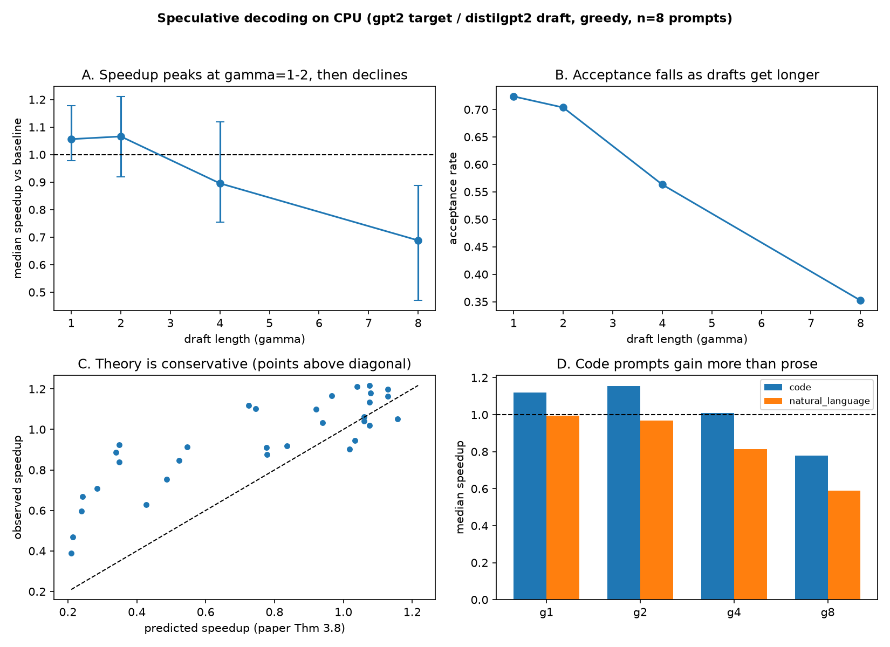
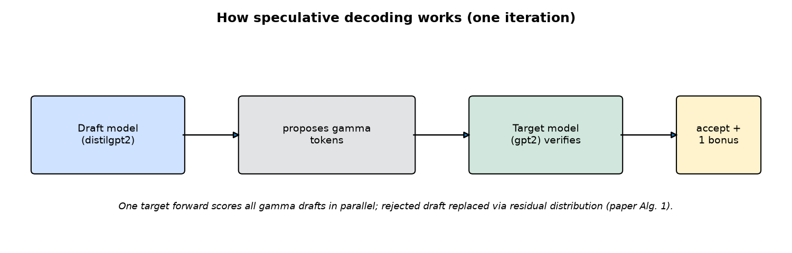

# Empirical reproduction of speculative decoding (Leviathan et al. 2023)

[](https://doi.org/10.5281/zenodo.23413380)

Research question: **how does draft length gamma affect measured speedup, and
how well does the paper's theory (Thm 3.8) predict it across prompt types?**

- H1: throughput vs gamma rises to an empirical optimum, then flattens/declines;
  optimum set by acceptance rate alpha and cost ratio c.
- H0: gamma has no meaningful effect within uncertainty.

Draft model `distilgpt2` (82M) proposes tokens; target `gpt2` (124M) verifies.
Greedy decoding (T=0), CPU-only, fp32. See `docs/paper_notes.md` (paper
methodology) and `docs/experimental_protocol.md` (variables, metrics, stats).



## How it works



## Setup

```bash
python3 -m venv .venv && ./.venv/bin/pip install -r requirements.txt
./.venv/bin/python scripts/inspect_env.py   # hardware check -> results/env.json
```

## Reproduce (commands in order)

```bash
./.venv/bin/python -m pytest tests/ -q        # correctness + theory tests
./.venv/bin/python scripts/smoke_test.py      # tiny random-model equivalence
./.venv/bin/python scripts/run_benchmark.py   # full matrix -> results/raw/run_*.json
./.venv/bin/python scripts/analyze.py results/raw/<run>.json
```

`analyze.py` writes `results/processed/{per_prompt,summary_by_gamma,summary_by_category}.csv`
and `figures/1..5_*.png`, and prints the headline numbers.

## Findings (run `results/raw/run_20261010T131248Z.json`; see `reports/research_report.md`)

Correctness: **120/120** speculative generations token-identical to the baseline.

| gamma | median speedup | 95% CI | acceptance | predicted (Thm 3.8) |
|---|---|---|---|---|
| 1 | **1.056** | [0.977, 1.179] | 0.724 | 1.070 |
| 2 | **1.066** | [0.919, 1.211] | 0.704 | 0.990 |
| 4 | 0.896 | [0.754, 1.119] | 0.563 | 0.636 |
| 8 | 0.688 | [0.470, 0.888] | 0.352 | 0.264 |

- Speedup peaks at gamma=1-2, then declines to a significant slowdown at gamma=8.
- Target forward passes cut up to 5x (40 -> 8) with identical tokens.
- Code prompts gain more than prose at every gamma (g1: 1.12x vs 0.99x).
- Theory check: the paper's cost term validates within ~10%; its i.i.d. assumption
  underpredicts tokens/iteration under correlated acceptance, so it is conservative here.
- Verdict: H1 hump shape supported; peak gain modest (draft nearly as costly as target
  on CPU, measured c=0.61 vs <0.05 in the paper); large-gamma decline is significant.

Detailed plots: [speedup vs gamma](figures/1_speedup_vs_gamma.png) ·
[acceptance vs gamma](figures/2_acceptance_vs_gamma.png) ·
[predicted vs observed](figures/3_pred_vs_obs.png) ·
[throughput](figures/4_throughput.png) ·
[by category](figures/5_by_category.png). Regenerate all with
`./.venv/bin/python scripts/make_readme_figures.py results/raw/<run>.json`.

## Key deviations from the paper (details in report)
- Small public models (gpt2/distilgpt2) instead of T5-XXL/LaMDA; CPU, fp32.
- Full-context forward passes (no KV-cache); verification still 1 target
  forward per iteration, same as paper's cost model.
- Greedy (T=0) evaluation only; sampling path implemented + unit-tested.


## Reference

This project is an independent empirical reproduction of the speculative
decoding method described in:

Yaniv Leviathan, Matan Kalman, and Yossi Matias.
*Fast Inference from Transformers via Speculative Decoding.*
Proceedings of the 40th International Conference on Machine Learning (ICML), 2023.

- [Paper (PMLR)](https://proceedings.mlr.press/v202/leviathan23a.html)
- [arXiv preprint](https://arxiv.org/abs/2211.17192)

This project independently implements the method and investigates how
draft length affects empirical speedup and the accuracy of theoretical
predictions under CPU-only execution.
