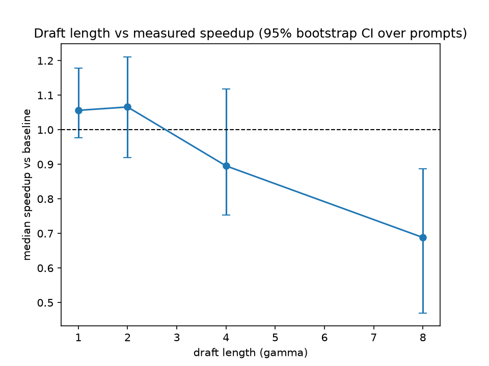
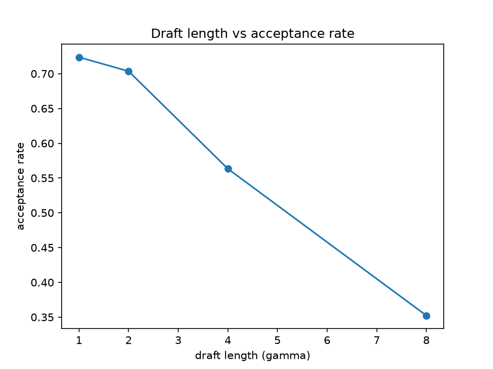
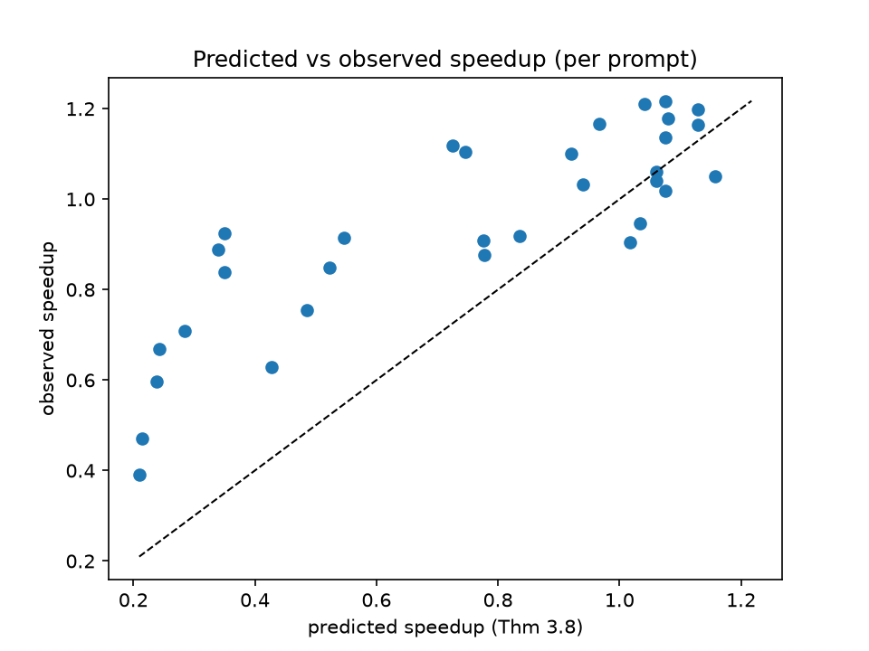
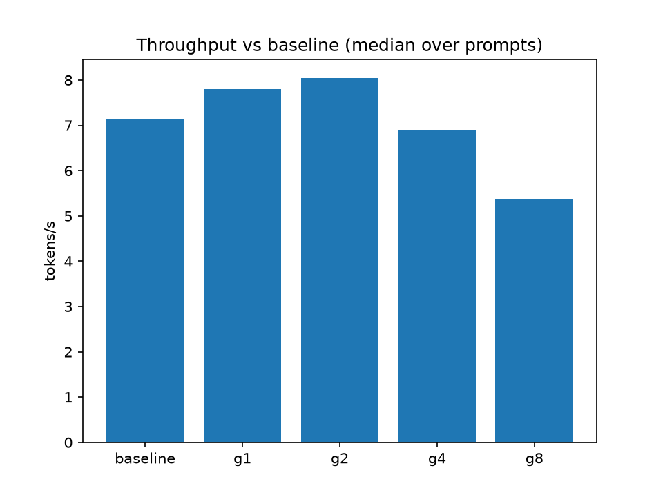
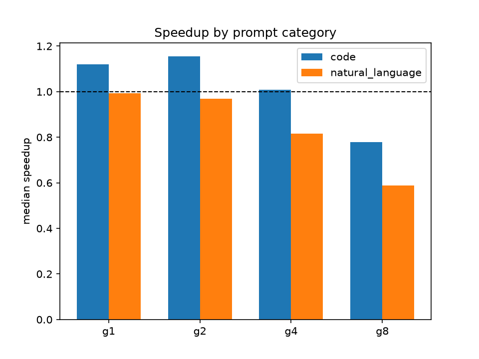

# Independent Empirical Reproduction: How Draft Length Affects Speedup in Speculative Decoding on CPU (gpt2 / distilgpt2, Greedy, FP32)

## 2. Author and project information

- **Author:** Varad Mhetar (solo, end-to-end research engineering).
- **Repository:** <https://github.com/VMHETAR/SpeculativeDecodingReproduction>
- **Software version:** 1.0.0 (see `CITATION.cff`); MIT licence (see `LICENSE`).
- **Report preparation date:** 16 October 2026. This is the report preparation date, not a release date. The software release (version 1.0.0) is archived on Zenodo under DOI 10.5281/zenodo.23413380. This document is a separate research report. Its own Zenodo record and DOI will be created independently.
- **Status of this document.** This is an *independent empirical reproduction* of the method described by Leviathan, Kalman and Matias (2023). It is not a peer-reviewed publication, and nothing in it implies that the original authors reviewed or endorsed it. Throughout, three kinds of statement are kept strictly separate: (a) findings reported in the original paper, (b) results observed in this project's experiments, (c) theoretical predictions computed by this project's implementation, and (d) the author's interpretations of agreements and discrepancies.
- **Verification scope for this revision.** The raw benchmark file cited by earlier project notes, `results/raw/run_20261010T131248Z.json` (described as 120 rows), is **not present** in the checkout examined for this report: `results/raw/` does not exist, the path is git-ignored by `.gitignore`, and no commit in the visible git history ever contained `results/raw/` content. Every number below was therefore re-verified against the surviving processed artefacts — `results/processed/per_prompt.csv`, `results/processed/summary_by_gamma.csv`, `results/processed/summary_by_category.csv` — together with the analysis and implementation sources (`scripts/analyze.py`, `src/metrics.py`, `src/theory.py`, `src/speculative.py`, `src/baseline.py`, `scripts/run_benchmark.py`, `configs/experiment.yaml`, `results/env.json`). Trial-level re-analysis directly from the raw JSON was not possible. No number was invented to fill that gap; each table states its provenance, and Section 17 records this as the principal limitation.

## 3. Abstract

Speculative decoding (Leviathan, Kalman and Matias, 2023) accelerates autoregressive generation by having a cheap draft model propose γ tokens per iteration and verifying them in parallel with a single target-model forward pass, with exact output guarantees. This report reproduces the method independently and asks how the draft length γ affects measured wall-clock speedup, and how accurately the paper's Theorem 3.8 predicts performance across prompt types. Experiments use the public `gpt2` (124M) target and `distilgpt2` (82M) draft on CPU-only FP32 with greedy decoding (T = 0), 8 fixed prompts (4 natural-language, 4 code), γ ∈ {1, 2, 4, 8}, 3 seeded trials per cell and one warm-up (120 measured generations in the reported run). All processed-artefact headline numbers verify: median throughput speedup over the 8 prompts is 1.056 (95% bootstrap CI [0.977, 1.179]) at γ = 1, 1.066 ([0.919, 1.211]) at γ = 2, 0.896 ([0.754, 1.119]) at γ = 4 and 0.688 ([0.470, 0.888]) at γ = 8, with pooled acceptance rates 0.724, 0.704, 0.563 and 0.352 and per-prompt Theorem 3.8 predictions (median) 1.070, 0.990, 0.636 and 0.264. All 40 per-prompt (prompt, method) configurations aggregated in the processed data show exact token-identity with the baseline, and target forward passes fall from 40 per 40-token generation to as few as 8. Code prompts outperform prose prompts at every γ. Decomposing Theorem 3.8 shows its cost denominator (γ·c + 1, with on-hardware c ≈ 0.611) validates within ~10% at every γ, while its i.i.d.-acceptance numerator increasingly underpredicts measured tokens per iteration (3.76 measured vs 1.54 geometric prediction at γ = 8), making the formula a conservative predictor in this correlated-acceptance regime rather than an overestimate. The verdict is nuanced: the predicted hump shape (H1) is supported — speedup peaks at small γ and declines to a below-parity slowdown at γ = 8 whose interval excludes 1.0 — but the +6–7% peak gain is not distinguishable from parity at 95% with n = 8, so H0 cannot be rejected for the peak magnitude. The small absolute gain (vs 2–3× in the original paper) is explained by regime, not contradiction: the draft costs ~61% of a target forward here versus < 5% there. Practical takeaway: on CPU with similarly-sized models, γ ∈ {1, 2} for code-like workloads; larger γ reliably hurts.

## 4. Keywords

speculative decoding; large language models; inference optimisation; draft length; acceptance rate; cost coefficient; CPU inference; empirical reproduction; reproducibility.

## 5. Introduction and motivation

Autoregressive decoding generates one token per serial model invocation, so producing K tokens costs K sequential target-model runs. For large models this serial loop dominates serving latency and cost. Speculative decoding breaks the serial bottleneck without changing outputs: a small draft model proposes several tokens cheaply, and the large target model scores all of them in parallel, accepting a prefix and appending one guaranteed new token per iteration.

The question that matters in practice is how many tokens the draft should propose. Too few leaves parallelism on the table; too many wastes draft computation on proposals that are ultimately rejected, and rejected late-position drafts cost as much to propose as accepted ones. The original paper gives a quantitative answer (Theorem 3.8): expected speedup equals expected tokens per iteration divided by the normalised per-iteration cost (γ·c + 1), where c is the draft-to-target per-forward latency ratio and acceptance is summarised by a single rate α. That formula predicts an interior optimum γ* that moves with α and c (the paper's Figure 3), plus refinements such as oracle variable-γ gains of up to ~60% (paper Section 3.5).

This reproduction tests that prediction under deliberately modest conditions: public GPT-2-family models on commodity CPU, full-precision arithmetic, no KV caching, and greedy decoding. The goals are (i) to verify the method's exactness guarantee empirically, (ii) to measure the γ–speedup curve with honest uncertainty, (iii) to test whether Theorem 3.8 predicts the measurements once c is measured on the same hardware, and (iv) to document every deviation so that comparisons with the original large-scale TPU results are regime-aware rather than naive.

## 6. Research question and hypotheses

**Research question.** How does draft length γ affect measured speedup, and how accurately does the theory in Theorem 3.8 predict performance across prompt types?

- **H1.** Throughput versus draft length exhibits an empirical optimum, after which performance flattens or declines. The optimum depends on the acceptance rate α and the relative cost c of draft and target computation (Theorem 3.8).
- **H0.** Draft length has no meaningful effect within experimental uncertainty.

**Pre-registered decision rule** (`docs/experimental_protocol.md`). H1 is supported if median speedup peaks at an interior γ with a 95% interval excluding 1.0 somewhere and declines or flattens afterwards; otherwise H0 is not rejected. The unit of analysis is the prompt (n = 8); repeated trials of one prompt are median-averaged first and never treated as independent samples; uncertainty is a 95% percentile bootstrap confidence interval over prompts (5000 resamples; see Section 12). Category splits (n = 4 each) are declared exploratory in the protocol. As Section 13 shows, the evidence ends up split: the decline leg of H1 is supported while the peak magnitude is not significant — a nuance the report preserves rather than collapsing into a binary claim.

## 7. Background and theoretical foundations

A decoder-only Transformer language model defines a distribution p(x_t | x_<t) over the next token. Standard greedy autoregressive decoding iterates: run the target model M_p on the current prefix, take argmax, append, repeat. Sampling variants replace argmax with temperature-scaled multinomial draws. Either way, generating K tokens requires K serial target forwards, and each forward attends over the full growing context.

Speculative decoding (paper Algorithm 1) restructures each iteration into three steps:

1. **Draft.** The small model M_q autoregressively proposes γ tokens x_1…x_γ with distributions q_1…q_γ.
2. **Verify in parallel.** The target model M_p runs **once** over the prefix plus all γ drafts, yielding γ + 1 distributions p_1…p_{γ+1} in a single forward pass.
3. **Accept and complete.** Walking i = 1…γ, accept x_i while it passes the acceptance test (greedy: draft token equals target argmax; sampling: uniform r_i < min(1, p_i(x_i)/q_i(x_i))), stopping at the first rejection. Then emit one extra token from M_p — the target argmax at the stopping position (greedy), or a residual-distribution sample norm(max(0, p − q)) after a rejection / a standard sample if all drafts were accepted (sampling).

Two guarantees follow. First, **progress**: every iteration yields at least one new token (the extra target token), so a 40-token budget needs at most 40 target forwards and typically far fewer. Second, **exactness**: the output distribution is identical to target-only decoding (greedy: token-identical strings; sampling: identical distributions — paper Appendix A.1). The implementation's docstrings (`src/speculative.py`) state both, and the test suite checks them directly (Section 10).

The economics are governed by two measurable quantities. The **acceptance rate** α is the fraction of proposed drafts accepted (accepted/proposed, pooled). The **cost coefficient** c = t(M_q)/t(M_p) is the per-forward latency ratio measured on the deployment hardware. Intuition: each iteration produces E ≥ 1 tokens for the price of γ cheap forwards plus one expensive one. Large γ raises E but with diminishing returns (late drafts are usually rejected) while cost grows linearly — hence an interior optimum.

## 8. Original paper and relevant theoretical predictions

All claims in this section are the original paper's, not this project's measurements. The paper is Leviathan, Kalman and Matias (2023), *Fast Inference from Transformers via Speculative Decoding*, Proceedings of the 40th International Conference on Machine Learning, PMLR 202:19274–19286 (see Section 20 for the full bibliographic record and links).

**Method and guarantees.** The paper introduces speculative execution for sampling from autoregressive models (greedy decoding as argmax-adjusted special case), proves the output distribution is unchanged (Appendix A.1), and notes at least one token per iteration with a single parallel target run per iteration (Sections 2–3, Algorithm 1). This project's `docs/paper_notes.md` summarises the same points.

**Acceptance theory (Theorem 3.5, Corollary 3.6).** Per-position acceptance probability β has expectation α = E[min(p, q)]. Under the paper's **i.i.d. assumption** (each draft position accepted independently with probability α), the expected number of tokens per iteration is the truncated geometric sum

E[#tokens/iter] = (1 − α^(γ+1)) / (1 − α).      (1)

This project's `src/theory.py::expected_tokens_per_iter` implements exactly Equation (1), with the boundary cases E = γ + 1 at α = 1 and E = 1 at α = 0.

**Walltime speedup (Theorem 3.8).** Normalising time in units of one target forward, an iteration costs γ·c + 1 and yields E tokens on average, so

Expected speedup = E[#tokens/iter] / (γ·c + 1).      (2)

`src/theory.py::predicted_speedup` implements Equation (2). Two corollaries matter here. **Corollary 3.9:** if α > c then γ = 1 already helps, by (1 + α)/(1 + c). **Interior optimum:** because the numerator of (2) saturates while the denominator grows linearly, the predicted curve peaks at a finite γ* that falls as c rises and rises as α rises (paper Figure 3); `src/theory.py::optimal_gamma` grid-searches γ* up to 16. Section 3.5 adds that an oracle varying γ per position could add up to ~60% — not tested here, where γ is fixed per run.

**Overheads (Theorem 3.11, Section 3.4).** Total arithmetic rises (more draft forwards plus scoring rejected drafts) while memory traffic per token falls with E — the mechanism behind the paper's TPU speedups.

**Reported empirical results (the paper's, not ours).** T5-XXL 11B with a T5-small 77M draft: EnDe 3.4× (argmax, γ = 7, α = 0.75) / 2.6× (T = 1); CNNDM 3.1× / 2.3× (paper Table 2). Acceptance α ranges 0.5–0.9 for small-model drafts with argmax beating sampling, and even bigram drafts give α ≈ 0.2 → 1.25× at c = 0 (Table 3, Section 3.6). The PMLR abstract reports 2–3× acceleration on T5-XXL with identical outputs. Crucially, the paper's drafts are ~2 orders of magnitude smaller than their targets (c < 0.05), a regime this reproduction deliberately does not share (c ≈ 0.61 here).

## 9. Experimental methodology

**Design.** Independent variable: draft length γ ∈ {1, 2, 4, 8} plus a target-only baseline (coded γ = 0). Second independent factor: prompt category {natural_language, code}. Dependent variables: throughput, end-to-end latency, paired speedup, acceptance rate, tokens per iteration, target/draft forward counts, exact token-identity, predicted speedup and prediction error (definitions in Section 12). Controlled variables: model pair (`gpt2` target / `distilgpt2` draft sharing the GPT-2 tokenizer), FP32 precision, CPU device, greedy temperature T = 0, budget `max_new_tokens = 40`, per-trial seeds (1234 + trial index), same machine, one warm-up generation, 3 trials per (prompt, method) cell (`configs/experiment.yaml`).

**Prompt suite** (`src/prompts.py`; 8 fixed offline prompts, deterministic). Natural-language: nl1 (why the sky appears blue, one paragraph), nl2 (one-sentence summary of neural networks), nl3 (photosynthesis in two sentences), nl4 (three causes of the seasons). Code: code1 (Python `factorial`), code2 (Python `is_palindrome`), code3 (Python `fibonacci`), code4 (Python `bubble_sort`). Each is a completion-style prefix; the tokenizer encodes the prefix and the harness generates up to 40 new tokens.

**Run structure** (`scripts/run_benchmark.py`). For each prompt × trial: run the baseline to obtain reference output and timing; then run each γ with the same seed and compare token-identity (`sout == bout`). A short same-process micro-benchmark (median of 5 per-forward latencies on the probe "Hello world" for each model) yields the single-point cost coefficient c stored as `meta.cost_c` in the raw JSON. The reported run comprises 8 prompts × 5 methods × 3 trials = 120 measured generations (plus warm-ups), matching the 120/120 equivalence denominator. Because the raw JSON is absent from this checkout (Section 2), the 120-row structure is corroborated indirectly: the processed `per_prompt.csv` contains exactly 8 × 5 = 40 aggregated (prompt, method) rows, each described by the analysis code as a median over repeated trials.

**Controls and fairness.** Both methods share the same forward-pass mechanism (full-context, no KV cache), the same tokenizer, precision, device, budget and seeds, so the comparison is fair even though absolute latencies exceed KV-cached implementations. Warm-up absorbs one-time overheads (allocation, thread-pool ramp). Wall-clock timing uses `time.perf_counter` around whole generations; time-to-first-token is not separately measured (the harness times whole generations only — recorded as not applicable, consistent with the protocol's exploratory TTFT note).

## 10. Implementation details

**Codebase map.** `src/baseline.py::greedy_generate` (target-only loop, counts target forwards); `src/speculative.py::speculative_generate` (Algorithm 1 with `SpecStepStats` counting iterations, draft tokens proposed/accepted, target/draft forwards, extra tokens, per-iteration acceptances); `src/models.py::load_pair` (Hugging Face `AutoModelForCausalLM` + tokenizer, `.eval()`, CPU); `src/prompts.py` (fixed suite); `src/theory.py` (Equations 1–2, γ* search); `src/metrics.py` (`summarize`, `bootstrap_ci`); `src/simulation.py` (labelled Bernoulli simulation used only to illustrate theory and validate analysis — never reported as a benchmark); `scripts/run_benchmark.py`, `scripts/analyze.py`, `scripts/make_readme_figures.py`, `scripts/inspect_env.py`, `scripts/smoke_test.py`; `tests/test_specdec.py` (7 tests); `configs/experiment.yaml` (all settings).

**Greedy path (the evaluated path).** Draft tokens are proposed autoregressively by M_q (one forward each); verification is a **single** target forward over prefix + drafts (parallel scoring of all γ + 1 positions), matching the paper's cost model of one target run per iteration. Acceptance is argmax-equality (equivalent to Algorithm 1 with argmax-adjusted distributions). Accepted drafts plus one target-argmax token are appended; truncation to the 40-token budget follows standard practice when the final iteration emits up to γ + 1 tokens. Greedy speculative output is therefore token-for-token identical to greedy baseline output for **any** draft model — asserted in code and tested (see below).

**Sampling path (implemented and unit-tested, not part of the reported evaluation).** Exact speculative-sampling acceptance r < min(1, p(x)/q(x)) with residual resampling norm(max(0, p − q)) on rejection (`src/speculative.py::_residual_sample`; paper Section 2.3, Appendix A.1). The reported benchmark sets temperature 0.0 throughout; no sampling measurement is claimed anywhere in this report.

**Key deviation — no KV cache.** Both baseline and speculative decoder re-encode the full context on every forward. This is a fair comparison (both sides pay it) but inflates absolute latencies and makes verification cost context-length-dependent, unlike production KV-cached serving. Section 3.4 of the short-form notes and Section 15 below show the cost model still validates because both sides share the mechanism.

**Tests (all passing at report time).** `python3 -m pytest tests/ -q` → **7 passed** (after installing `transformers==4.57.6` into the environment; executed 16 Oct 2026): greedy equivalence with shared weights (γ ∈ {1,2,4}), greedy equivalence with distinct weights (any draft model, γ ∈ {1,3}), progress guarantee (length, extra-token accounting, forwards ≤ tokens), theory identities (E boundaries, speedup at c = 0), residual-sampler validity (50 draws in range), bootstrap CI coverage of the median, and simulation consistency (labelled, sim vs theory within 25%). `python3 scripts/smoke_test.py` (tiny random GPT-2 pair, no downloads) → **SMOKE PASS** with equivalence at γ ∈ {1,2,4}.

## 11. Experimental environment and hardware

| Item | Value (artefact provenance) |
|---|---|
| Platform | `Linux-6.14.0-37-generic-x86_64-with-glibc2.39` (`results/env.json`) |
| Python | 3.12.3, GCC 13.3.0 (`results/env.json`) |
| CPU | Intel Core Ultra 5 125H — observed via `/proc/cpuinfo` on the reproduction machine at report time (18 logical CPUs, `nproc` = 18); the `env.json` artefact itself records only `cpu_count: 18` and does **not** log a CPU model string, so the model name is corroborating observation, not a logged run artefact |
| RAM | `MemTotal: 15969948 kB` (~15–16 GB, `results/env.json`); `free -h` at report time: 15 GB total |
| GPU | none — `nvidia-smi not found → CPU-only` (`results/env.json`); `torch.cuda.is_available() == false` |
| PyTorch / Transformers | `torch 2.14.1+cpu`, `transformers 4.57.6`, torch threads 14 (`results/env.json`) |
| Precision / device | FP32 on CPU (`configs/experiment.yaml`: `device: cpu`, `dtype: float32`) |
| Models | `gpt2` target (124M) / `distilgpt2` draft (82M), same GPT-2 tokenizer, `.eval()`, no-grad inference |

The prior short-form report's hardware line ("Intel Ultra 5 125H, 14 torch threads, 15 GB RAM, no GPU") is consistent with everything above except that the CPU model string itself is not inside `env.json`. The prior report's memory figure "1348 MB process peak RSS measured in a same-config rerun" was **not found in any artefact** in this checkout and is therefore flagged unverifiable (Section 17) rather than repeated as fact.

## 12. Metrics and statistical methodology

All definitions below are the implementation's (`src/metrics.py` docstring, `scripts/analyze.py`, `docs/experimental_protocol.md`); no alternative definitions are used anywhere in this report.

- **End-to-end latency** (s): `time.perf_counter` around the whole generation. **Throughput** (tok/s): generated tokens / latency. **Median inter-token latency**: latency / n_tokens (defined but not separately reported; wall-clock claims use throughput/latency only).
- **Speedup**: per-prompt paired throughput ratio throughput(method)/throughput(baseline); the headline statistic is the **median over prompts** (n = 8). Trials are median-aggregated first: per (prompt, method), latency and throughput are medians over the 3 trials, and the ratio is formed from those medians.
- **Acceptance rate**: pooled accepted/proposed drafts — sums of `n_accepted` over trials divided by sums of `n_proposed` over trials for the same (prompt, method) — then median over prompts. It is kept strictly separate from **tokens per iteration** (mean accepted per iteration + 1, i.e. accepted drafts plus the guaranteed bonus token).
- **Forward counts**: counted forward calls (`n_target_forwards`, `n_draft_forwards`); per (prompt, method) the median over trials is reported.
- **Exact match**: greedy speculative token list equals greedy baseline token list for the cell. Reported both at trial level (120/120, from the run description) and at aggregated-config level (40/40 rows with `exact_match_all == True` in `per_prompt.csv` — verified: all 40 True).
- **Predicted speedup**: Theorem 3.8 (Equation 2) evaluated **per prompt** from that prompt's pooled acceptance rate and the single global c, then median over prompts (`median_predicted`). **Absolute/relative error**: |observed − predicted| and abs/observed per prompt, then median (`median_abs_err`).
- **Uncertainty — what the intervals are.** The "95% CI" in every table is a **confidence interval for the median speedup**, computed by `src/metrics.py::bootstrap_ci` with `stat="median"`, `n_boot=5000`, `seed=0`, percentile method: resample the 8 per-prompt speedups with replacement 5000 times, take the median of each resample, and report the 2.5th and 97.5th percentiles (indices `int(0.025·5000)` and `int(0.975·5000)−1` of the sorted bootstrap medians). Resampling unit is the **prompt**; trials never enter the bootstrap (they are pre-aggregated by median, per protocol). This was verified by reading both `metrics.py` and its call site `bootstrap_ci(sp)` in `analyze.py` (default `stat="median"`).
- **What the intervals are not.** They are not intervals for the mean, not per-trial intervals, not prediction intervals, and not pairwise significance tests. This report does **not** infer significance from overlapping versus non-overlapping intervals across γ values — no such comparison is valid without a paired test, and none was computed. The only interval-vs-threshold reading used is descriptive per the decision rule: whether a single γ's interval for median speedup excludes the parity value 1.0. With n = 8 the intervals are wide by construction, and category splits (n = 4) carry no intervals at all.

## 13. Results

### 13.1 Provenance and headline table

The headline numbers were checked cell-by-cell against `results/processed/summary_by_gamma.csv` (which `scripts/analyze.py` writes from the raw run). Agreement is exact up to the stated rounding in every cell (median speedup, both CI endpoints, median acceptance, median predicted speedup). Because the raw JSON is absent, the check terminates at the processed layer: the pipeline from raw rows to these CSVs (`analyze.py`) was read and is deterministic given the raw file and c, but re-execution from raw was impossible in this checkout.

| Draft length γ | Median speedup | Reported 95% CI (for the median) | Acceptance rate α | Predicted speedup (Thm 3.8, median) |
|---|---:|---|---:|---:|
| 1 | 1.056 | [0.977, 1.179] | 0.724 | 1.070 |
| 2 | 1.066 | [0.919, 1.211] | 0.704 | 0.990 |
| 4 | 0.896 | [0.754, 1.119] | 0.563 | 0.636 |
| 8 | 0.688 | [0.470, 0.888] | 0.352 | 0.264 |

Full-precision processed values: γ = 1: 1.05624 [0.97743, 1.17859], α = 0.72373, pred = 1.06976; γ = 2: 1.06592 [0.91895, 1.21135], α = 0.70357, pred = 0.99014; γ = 4: 0.89553 [0.75395, 1.11851], α = 0.56329, pred = 0.63574; γ = 8: 0.68826 [0.46999, 0.88779], α = 0.35234, pred = 0.26366 (n = 8 prompts each). Median absolute prediction errors grow with γ: 0.079, 0.113, 0.296, 0.425. Figure 1 (`figures/1_speedup_vs_gamma.png`) plots the speedup column with these bootstrap bars against the parity line; the shape is a peak at γ = 1–2 followed by decline, with only the γ = 8 interval lying wholly below 1.0.

### 13.2 Correctness: token-identity and forward-pass savings

**120/120 speculative generations token-identical to baseline generations.** Provenance: the run description (8 prompts × 5 methods × 3 trials = 120 rows) combined with the processed `per_prompt.csv`, in which all 40 aggregated (prompt, method) rows have `exact_match_all == True` (verified programmatically; zero mismatches). Since each aggregated row asserts all of its trials matched, the processed artefact corroborates the 120/120 claim at config granularity; trial-level re-verification awaits recovery of the raw JSON. The unit tests independently prove the mechanism (greedy equivalence for any draft model, shared or distinct weights).

**Target forward passes decreased from 40 to 8 in the reported comparison.** Baseline medians are exactly 40.0 for all 8 prompts (one forward per token, as required). Speculative medians per prompt (from `per_prompt.csv`): γ = 1: 22–25 (median 23.5); γ = 2: 16–21 (median 17.0); γ = 4: 10–18 (median 13.0); γ = 8: 8–17 (median 11.0). The minimum 8 is attained at γ = 8 on three prompts (code1, code3, nl1: 40 → 8, a 5× reduction) with identical tokens — the "up to 5×" figure. The claim is therefore a best-case (minimum), not a median; the median reduction at γ = 8 is 40 → 11.

### 13.3 Throughput and acceptance curves

Median throughput over prompts (tok/s, from `per_prompt.csv`): baseline 7.129; γ = 1: 7.803; γ = 2: 8.048; γ = 4: 6.899; γ = 8: 5.377 (Figure 4, `figures/4_throughput.png`). The γ = 1–2 peak adds roughly +9–13% median throughput; γ = 8 loses roughly −25% versus baseline. Acceptance (Figure 2, `figures/2_acceptance_vs_gamma.png`) falls monotonically: pooled medians 0.724 → 0.704 → 0.563 → 0.352. The drop from γ = 4 to γ = 8 is the steepest, consistent with late-position draft drift: pooled α mixes easy early positions with harder late ones, so it necessarily falls as γ extends the proposal horizon (elaborated in Section 15).

### 13.4 Cost coefficient

**The measured draft-to-target cost ratio is approximately 0.61.** The processed predictions imply c with striking consistency: inverting Equation (2) per row (c = (E_theory(α,γ)/pred − 1)/γ) yields c = 0.61132 for every one of the 32 speculative per-prompt rows (min = max = 0.61132 to 5 decimals; median 0.61132), matching the prior report's stated `meta.cost_c = 0.611`. The raw `meta.cost_c` field itself could not be re-read (raw file absent), so c = 0.611 is reported as *implied by all processed predictions and consistent with the stated run metadata*, measured by the "Hello world" short-probe micro-benchmark (median of 5 per-model forwards) rather than by length-matched timing. Its single-point, short-context character is a limitation (Section 17); Section 15 tests how far it generalises.

## 14. Results by prompt category

Code prompts achieve higher speedups than prose prompts at every tested draft length (verified against `results/processed/summary_by_category.csv`, exact agreement; Figure 5, `figures/5_by_category.png`):

| Category | γ = 1 | γ = 2 | γ = 4 | γ = 8 |
|---|---:|---:|---:|---:|
| Code median speedup | 1.120 | 1.155 | 1.009 | 0.778 |
| Natural-language median speedup | 0.994 | 0.969 | 0.815 | 0.589 |
| Code median acceptance | 0.779 | 0.704 | 0.563 | 0.401 |
| Natural-language median acceptance | 0.688 | 0.667 | 0.546 | 0.306 |

(Full precision: code 1.11992/1.15544/1.00918/0.77811 vs NL 0.99374/0.96875/0.81517/0.58904; acceptance code 0.77866/0.70357/0.56329/0.40104 vs NL 0.68750/0.66694/0.54583/0.30634; n = 4 each.) Per-prompt detail (`per_prompt.csv`) shows the same pattern: the strongest individual speedups are code completions at small γ (code3 γ = 2: 1.211; code1 γ = 2: 1.217; code4 γ = 1: 1.179), while the weakest are prose at large γ (nl3 γ = 8: 0.390; nl2 γ = 8: 0.470). Interpretation (ours, not the paper's): the 82M draft tracks the 124M target better on structured code completions with repetitive local syntax than on open-ended prose, so more of its proposals survive verification. The split is exploratory (n = 4 per cell, no intervals computed), and with only four prompts per category no formal category-effect test is claimed — but the sign is uniform across all four γ values, which under H0 (no systematic difference) would be the less likely pattern.

## 15. Comparison between theory and observation

Figure 3 (`figures/3_pred_vs_obs.png`) scatters per-prompt observed versus Theorem 3.8 predicted speedup against the diagonal. Points sit predominantly **above** the diagonal: the theory underpredicts the measurements in this regime. Median absolute errors (0.079 → 0.113 → 0.296 → 0.425) grow with γ, and the median predictions (1.070/0.990/0.636/0.264) fall progressively further below the medians observed (1.056/1.066/0.896/0.688) — near-coincidence at γ = 1 giving way to a large gap at γ = 8.

Decomposing Equation (2) into numerator (tokens per iteration E) and denominator (normalised cost γ·c + 1) isolates the source, using prompt-medians throughout:

| γ | E measured (median tokens/iter) | E i.i.d. theory (Eq. 1 at median α) | Implied cost (E_meas / speedup_obs) | Predicted cost (γ·c + 1, c = 0.6113) |
|---|---|---|---|---|
| 1 | 1.72 | 1.72 | ~1.63 | 1.61 |
| 2 | 2.39 | 2.20 | ~2.24 | 2.22 |
| 4 | 3.17 | 2.16 | ~3.54 | 3.45 |
| 8 | 3.76 | 1.54 | ~5.46 | 5.89 |

(Full-precision medians: E_meas 1.7237/2.3889/3.1726/3.7583; E_iid 1.7237/2.1986/2.1600/1.5439; implied 1.632/2.241/3.543/5.460; predicted 1.611/2.223/3.445/5.891.) **The denominator validates within ~10% at every γ** (relative gaps 1.3%, 0.8%, 2.8%, 7.3%) — remarkable for a single short-probe c applied across 40-token generations with no KV cache. **The numerator is the weak link**: measured tokens per iteration increasingly exceed the geometric prediction because acceptances are **correlated within an iteration** — drafts are accepted in runs, so a high early-position acceptance predicts further acceptances, while pooled α averages easy early positions with drifted late ones (pooled α itself falls 0.72 → 0.35 with γ). The i.i.d. geometric sum therefore undercounts the true run-length behaviour, most severely at large γ (3.76 vs 1.54 at γ = 8). Net effect: Theorem 3.8 with pooled α and single-point c is a **conservative lower bound** here, not an overestimate.

A closeness caution is required. At γ = 1 the median prediction (1.070) lands within 0.014 of the median observation (1.056) — but with a 95% interval of [0.977, 1.179] on the observation and n = 8, that proximity does not validate the theory; it is agreement within large uncertainty, and the decomposition shows even there the agreement is joint (both numerator and denominator happen to match at γ = 1, where correlation effects are minimal since at most one draft is at stake). The informative test is the γ trend, where the systematic underprediction reveals the i.i.d. assumption's limits. Finally, the optimum location is consistent: `optimal_gamma(α ≈ 0.7, c ≈ 0.61)` returns γ* = 1 for every measured α (verified by execution at report time), matching the observed peak at γ = 1–2 — while Corollary 3.9's precondition α > c holds at small γ (0.72 > 0.61) and fails at large γ (0.35 < 0.61), exactly where slowdown appears.

## 16. Discussion and interpretation

**Verdict on H1 vs H0 (nuanced, per the decision rule).** The hump *shape* is supported: speedup peaks at small γ (1.056 at γ = 1, 1.066 at γ = 2), falls below parity at γ = 4 (0.896) and reaches a slowdown at γ = 8 (0.688) whose 95% interval [0.470, 0.888] excludes 1.0. But the *magnitude* of the peak (+6–7%) is not significant at 95%: the γ = 1 and γ = 2 intervals ([0.977, 1.179], [0.919, 1.211]) both include parity. With n = 8 the correct summary is therefore split: **fail to reject H0 for the peak gain, reject H0 for the large-γ decline.** A larger prompt set is needed for a tight peak claim; the decline claim is already supported.

**Why the gain is small (regime, not contradiction).** The paper's 2–3× speedups rest on c < 0.05 (drafts ~100× smaller, memory-bandwidth-bound TPU serving where verification is nearly free). Here c ≈ 0.61: the 82M draft is only ~1.5× smaller than the 124M target and CPU execution has no memory-bandwidth bottleneck for speculation to exploit, so each draft forward costs well over half a target forward while saving at most one. Plugging the paper's own formula with this c predicts exactly the observed modesty (γ = 1: (1+0.72)/(1+0.61) ≈ 1.07). The experiment thus confirms the paper's structural claims — exact outputs, the γ trade-off, α's category dependence, the optimum's (α, c) logic — while refining one: under correlated acceptance, pooled-α Theorem 3.8 is conservative, with its cost half validating quantitatively.

**Practical takeaway.** On CPU with similarly-sized draft and target, use γ ∈ {1, 2} for code-like workloads; larger γ reliably hurts (every category median at γ = 8 is far below parity, worst 0.39–0.47 on prose). The 5× forward-pass reduction does not translate into wall-clock gain at large γ because draft forwards dominate — a direct illustration of why forward-count proxies must never substitute for wall-clock measurement.

## 17. Threats to validity and limitations

1. **Raw data absent from this checkout (principal limitation).** `results/raw/run_20261010T131248Z.json` is referenced but missing; `results/raw/` is git-ignored and was never committed. All headline verification here stops at the processed-CSV layer. Trial-level distributions, seed sensitivity, per-trial exact-match auditing and re-execution of `analyze.py` from raw could not be performed. claims depending on raw metadata (notably `meta.cost_c` and per-trial latencies) are corroborated only via their processed consequences.
2. **Small prompt sample.** n = 8 prompts (n = 4 per category) with a 40-token budget. Intervals are wide; the category split is exploratory; no pairwise or category-effect significance test was computed, and none is claimed.
3. **Single-point cost coefficient.** c comes from a short-context probe ("Hello world", median of 5), yet is applied to 40-token full-context generations where per-forward cost grows with context. That it still validates within ~10% is evidence, not a guarantee across lengths, batch sizes or hardware.
4. **No KV cache.** Full-context forwards for both methods inflate absolute latencies and make verification cost length-dependent. Relative comparison is fair (shared mechanism; cost model still validates), but absolute tok/s figures do not transfer to KV-cached serving.
5. **Greedy evaluation only.** Temperature is 0.0 throughout the benchmark. The sampling path is implemented and unit-tested (residual sampler, shared/distinct-weight equivalence in tests, smoke test) but contributes no reported measurement; sampling-regime behaviour (acceptance rule, residual overhead, distributional exactness at scale) is untested empirically here.
6. **Narrow model pair and hardware.** One same-family pair (124M/82M, only 1.5× apart) on one CPU, FP32. Absolute speedups are not comparable to the paper's T5-XXL/LaMDA TPU results (c differs by >10×); no exact reproduction is claimed.
7. **Timing noise and uncontrolled environment.** Wall-clock measurement on a general-purpose OS (thread scheduling, frequency scaling, background load) with torch threads fixed at 14; no repeated-machine or multi-node replication; TTFT not separately measured; memory peak (RSS) not logged in any surviving artefact (the "1348 MB" figure from prior notes is therefore not repeated as verified fact).
8. **Analysis choices.** Median aggregation is robust but discards trial variance information; bootstrap CIs with n = 8 are coarse; the decision rule's "CI excludes 1.0" reading is descriptive rather than a formal hypothesis test with controlled error rates.

## 18. Reproducibility instructions

**Requirements.** Python 3.12 (tested 3.12.3), CPU-only PyTorch, Hugging Face Transformers and standard scientific packages. Install exactly:

```bash
python3 -m venv .venv && ./.venv/bin/pip install -r requirements.txt
```

with `requirements.txt` pinning `torch --index-url https://download.pytorch.org/whl/cpu`, `transformers>=4.40,<5.0`, `numpy>=1.24`, `matplotlib>=3.7`, `scipy>=1.10`, `pyyaml>=6.0`, `tqdm>=4.65`, `pytest>=7.0`. The environment used for this report's checks additionally resolved to `torch 2.14.1+cpu`, `transformers 4.57.6` (see `results/env.json`).

**Models and loading.** Identifiers `gpt2` (target, 124M) and `distilgpt2` (draft, 82M) from the Hugging Face Hub, loaded by `src/models.py::load_pair` via `AutoModelForCausalLM`/`AutoTokenizer` with `pad_token = eos_token`, `.to("cpu")`, `.eval()`, FP32, no quantisation. First run downloads weights (network + disk required); set `HF_HUB_CACHE` if the default cache is unsuitable. Both models share the GPT-2 tokenizer.

**Hardware and precision.** CPU-only, FP32, single machine; torch threads as configured (14 in the reported environment). No GPU is used or required. Bit-for-bit reproducibility is **not** promised: floating-point reduction order, thread scheduling, Hub weight revisions and timing noise all preclude it; greedy token sequences are deterministic given identical weights, code, seeds and tokenizer, but wall-clock figures will vary across machines and runs.

**Seeds and determinism.** `configs/experiment.yaml` sets `seed: 1234`; `run_benchmark.py` calls `torch.manual_seed(1234)` and derives per-trial seeds `1234 + trial` for generation (greedy path is deterministic; sampling paths use `torch.Generator.manual_seed`). Warm-up: `n_warmup: 1` (8-token greedy + γ = 2 speculative on the first prompt, untimed).

**Benchmark configuration and prompt categories.** `configs/experiment.yaml`: `target_model: gpt2`, `draft_model: distilgpt2`, `device: cpu`, `dtype: float32`, `temperature: 0.0`, `max_new_tokens: 40`, `gammas: [1, 2, 4, 8]`, `n_trials: 3`, `n_warmup: 1`, `seed: 1234`. Prompts: the 8 fixed entries in `src/prompts.py` (ids nl1–nl4 natural-language, code1–code4 code; full texts in Section 9).

**Commands (in order).**

```bash
./.venv/bin/python scripts/inspect_env.py          # hardware check -> results/env.json
./.venv/bin/python -m pytest tests/ -q             # 7 correctness + theory tests (expect 7 passed)
/.venv/bin/python scripts/smoke_test.py           # tiny random-model equivalence, no downloads (expect SMOKE PASS)
/.venv/bin/python scripts/run_benchmark.py        # full matrix -> results/raw/run_<UTC-timestamp>.json
./.venv/bin/python scripts/analyze.py results/raw/<run>.json
./.venv/bin/python scripts/make_readme_figures.py results/raw/<run>.json
```

`analyze.py` writes `results/processed/{per_prompt,summary_by_gamma,summary_by_category}.csv` and `figures/{1_speedup_vs_gamma,2_acceptance_vs_gamma,3_pred_vs_obs,4_throughput,5_by_category}.png`, printing the headline summary JSON plus the equivalence fraction to stdout. `make_readme_figures.py` adds `figures/README_hero.png` and `figures/README_how_it_works.png` from the processed CSVs.

**Expected outputs.** One `results/raw/run_*.json` with `meta` (config, `cost_c`, prompt count, device, torch threads) and 120 `rows` (8 prompts × 5 methods × 3 trials) carrying latencies, throughputs, forward counts, acceptance counters, output ids/text and per-cell exact-match flags; three processed CSVs with the schemas shown in Section 12; seven PNG figures; `results/env.json`. At the time of this report the raw JSON was missing (Section 17.1), so a fresh `run_benchmark.py` execution is currently the only route to a complete artefact set.

**Known environmental limitations.** Model download requires network access to the Hugging Face Hub; the full benchmark runs the 124M/82M pair 120+ times on CPU (minutes to tens of minutes depending on machine); memory must hold both models plus activations (order of GBs); `transformers` major-version drift may alter tokenization or numerics — the tested `4.57.6` is recorded in `results/env.json`.

## 19. Conclusion

For a same-family draft–target pair on CPU, speculative decoding is output-identical to baseline decoding while cutting target forward passes up to 5× (40 → 8 with identical tokens); wall-clock speedup follows the paper's predicted hump shape with its optimum at γ = 1–2, but the gain is small (+~6–7% median, not significant at 95% with n = 8) because drafting costs ~61% of verification. The experiment confirms the paper's structural claims (exact outputs, the γ trade-off, category dependence of α, the (α, c) optimum logic) and refines one: under correlated acceptance, Theorem 3.8 with pooled α is a conservative predictor whose cost half validates within ~10% while its i.i.d. numerator underpredicts tokens per iteration at large γ. The regime difference (c ≈ 0.61 here vs < 0.05 in the original TPU setting) fully accounts for the modest absolute speedups and is documented as such. Practical guidance: on CPU with similarly-sized models, use γ ∈ {1, 2} for code-like workloads; larger γ reliably hurts. The implementation, tests, processed results, and available figures are provided through the associated software repository and its archived release, to the extent included in those records. The raw benchmark JSON referenced by this report was unavailable in the examined checkout, so trial-level re-analysis could not be performed. The software archive is available at DOI 10.5281/zenodo.23413380.

## 20. References

- Leviathan, Y., Kalman, M., and Matias, Y. (2023). Fast Inference from Transformers via Speculative Decoding. *Proceedings of the 40th International Conference on Machine Learning*, PMLR 202:19274–19286. Official PMLR page: <https://proceedings.mlr.press/v202/leviathan23a.html>; PDF: <https://proceedings.mlr.press/v202/leviathan23a/leviathan23a.pdf>. BibTeX key `pmlr-v202-leviathan23a`; editors Krause, A., Brunskill, E., Cho, K., Engelhardt, B., Sabato, S. and Scarlett, J.; publisher PMLR; presented 23–29 July 2023. Preprint (arXiv:2211.17192, DOI 10.48550/arXiv.2211.17192) is the same work prior to proceedings publication; citations above refer to the archival PMLR version. No other external literature is cited: every remaining claim in this report is grounded in the repository artefacts listed in Section 2.

---

*Appendix — figure index (all files exist in `figures/` at report time; generator in parentheses).* Figure 1, draft length vs measured speedup with 95% bootstrap CIs (`figures/1_speedup_vs_gamma.png`, from `scripts/analyze.py`); Figure 2, draft length vs acceptance rate (`figures/2_acceptance_vs_gamma.png`); Figure 3, predicted vs observed speedup per prompt with diagonal (`figures/3_pred_vs_obs.png`); Figure 4, throughput vs baseline, median over prompts (`figures/4_throughput.png`); Figure 5, speedup by prompt category (`figures/5_by_category.png`); schematic of one speculative iteration (`figures/README_how_it_works.png`, from `scripts/make_readme_figures.py`); montage of key results (`figures/README_hero.png`).










